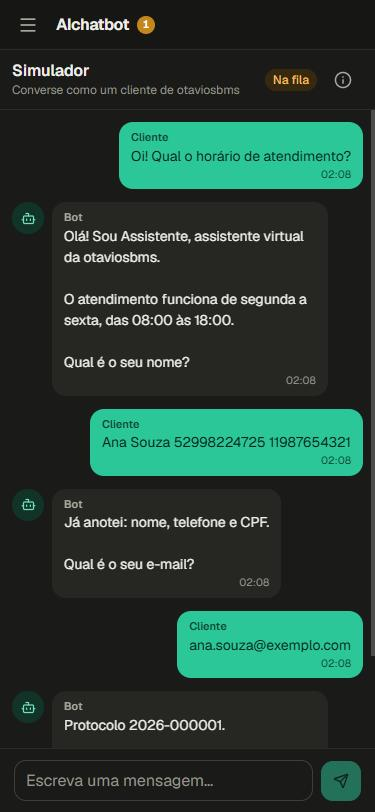
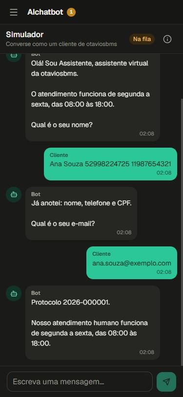
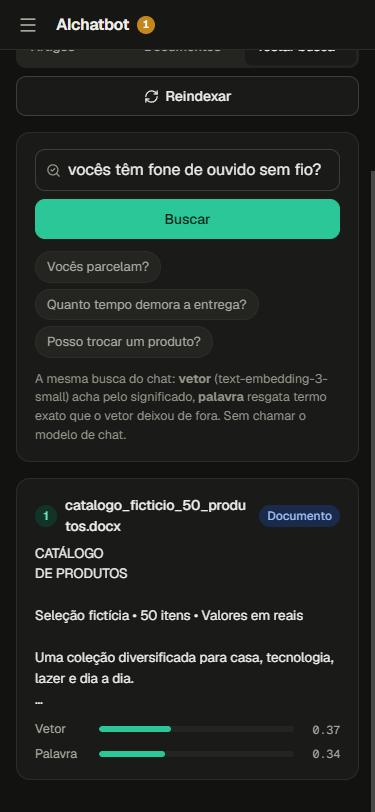
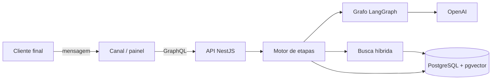

# AIchatbot — API

Chatbot de atendimento com agentes de IA, base de conhecimento com RAG e transferência para atendente humano. Projeto de portfólio, feito de ponta a ponta.

**No ar:** https://aichatbot.otaviosbms.com.br · **Front-end:** [ai-chatbot-front](https://github.com/otaviosbms/ai-chatbot-front)

<p>
  
  
  
</p>

## Destaques

- **Etapas configuráveis.** A empresa escolhe o que o bot pede (nome, e-mail, telefone, CPF), quando abre protocolo e quando passa para um humano, com ordem e mensagens próprias. Prompt e tool de cada etapa ficam no código; a empresa só grava a configuração.
- **O LLM propõe, o código confere.** Um grafo em LangGraph reescreve a fala, classifica a intenção e extrai os dados das etapas ainda vazias, inclusive fora de ordem: "Ana Souza 529.982.247-25 11 98765-4321" grava nome, CPF e telefone e o bot avisa o que anotou. Dígito verificador do CPF, DDD e celular com 9 são validados em código.
- **RAG híbrido medido.** PDF, DOCX, TXT e MD são cortados por seção e indexados com `text-embedding-3-small` no próprio Postgres (pgvector, índice HNSW). O vetor ordena pelo significado e o full-text em português resgata termo exato. Limiares e pesos saíram de `npm run avaliar:rag`: numa base de teste com 40 perguntas, o 1º lugar certo foi de 72% (só palavra) para 100%, e as perguntas sem resposta voltam vazias ([docs/07](docs/07-modulo-base-de-conhecimento.md)).
- **Guardrail e transferência humana.** Fala fora do escopo recebe contenção; passado o limite de tentativas, a conversa vai para a fila, o bot silencia e o atendente pode devolvê-la ao bot.
- **Multi-empresa.** Login por e-mail e senha (JWT, senha com scrypt). Cada conta só vê os dados da própria empresa, conferido por um guard global.

## Arquitetura



O turno completo está em [docs/02](docs/02-arquitetura.md).

## Stack

| Camada | Tecnologias |
|---|---|
| API | NestJS, TypeScript, GraphQL (Apollo, code-first), TypeORM |
| Banco | PostgreSQL com pgvector e unaccent |
| IA | LangGraph, OpenAI (chat e embeddings) |
| Documentos | pdf-parse, mammoth |
| Qualidade | Vitest (unitários e e2e), oxlint, Prettier, avaliação do RAG com PGlite |
| Infra | Docker, Cloudflare Tunnel |

## Rodando

Precisa de Node 22+ e de um PostgreSQL 16 com pgvector (imagem `pgvector/pgvector:pg16`).

```bash
npm install
cp .env.example .env
npm run migration:run
npm run start:dev
```

GraphQL em `http://localhost:3000/graphql` (`health` confere o banco).

**pgvector:** a busca do RAG usa a extensão `vector`. A imagem `postgres:16` oficial não a traz e a migration `TrechoConhecimento` falha. Em Postgres próprio ou gerenciado, instale ou habilite a extensão (o usuário precisa de permissão para `CREATE EXTENSION`).

| Variável | Para que serve |
|---|---|
| `DB_HOST`, `DB_PORT`, `DB_USERNAME`, `DB_PASSWORD`, `DB_NAME` | Conexão com o Postgres, da API e do CLI de migration. `DB_PORT` é 5432 se vazio. A variável do ambiente vence o `.env`. |
| `DB_MIGRATIONS_RUN` | `true` aplica as migrations pendentes quando a API sobe. |
| `DB_RETRY_ATTEMPTS`, `DB_RETRY_DELAY_MS` | Tentativas de conexão enquanto o banco inicia (padrão 10 a cada 3000 ms). |
| `LLM_MODO` | `servidor` (padrão): a API usa `LLM_API_KEY` e `LLM_MODEL` e o front não pede nada. `cliente`: o front pede a chave da OpenAI de quem usa e o modelo, e a chave do `.env` nunca é usada. |
| `LLM_API_KEY`, `LLM_MODEL` | Chave e modelo do modo servidor. |
| `EMBEDDING_MODEL` | Modelo de embedding do RAG. Padrão `text-embedding-3-small`; trocar exige reindexar. |
| `JWT_SECRET` | Obrigatória. Assina os tokens de login (mínimo de 32 caracteres; `openssl rand -hex 32`). Sem ela a API não sobe. Trocar desconecta todos. |
| `REGISTRO_ABERTO` | Padrão `true`: o painel mostra "Criar uma conta" e qualquer pessoa cria empresa e conta. `false` fecha o cadastro: crie contas com `npm run usuario:criar` ([docs/17](docs/17-autenticacao.md)). |
| `CORS_ORIGIN` | Origens do front que podem chamar a API, separadas por vírgula, ou `*`. Vazio libera só `localhost` e `127.0.0.1`, em qualquer porta. |

```bash
npm test                 # unitários
npm run test:e2e         # e2e (precisa do Postgres)
npm run avaliar:rag      # qualidade da busca, com embeddings reais e Postgres em memória
npm run migration:generate -- src/database/migrations/NomeDaMigration
npm run migration:revert
```

## Documentação

Tudo está em [docs/](docs/README.md): arquitetura, modelo de dados, cada módulo, camada LLM e RAG, contratos GraphQL e testes. Instruções para agentes de IA: [AGENTS.md](AGENTS.md) (espelhado em `CLAUDE.md`).

## Licença

[MIT](LICENSE)
