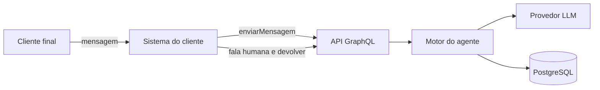

# 01 — Visão geral

API de chatbot de agentes prontos, vendida para o sistema do cliente integrar. O código traz nome, e-mail, telefone, CPF, protocolo e handoff, cada um com prompt e tool. A busca na base não é etapa: entra quando a fala pede um fato. A saudação é só o texto `persona.saudacao`, dito uma vez. A empresa escolhe a mensagem, a ordem e se cada agente fica ativo. A configuração dessa árvore é gravada pela própria API.

## Escopo

| Peça | O que faz |
|---|---|
| Agente | Uma etapa do catálogo: nome, e-mail, telefone, CPF, protocolo ou handoff. Prompt e tool ficam no código. A empresa grava mensagem, ordem e se está ativo. |
| Guardrail | Antes do entendimento: a fala cabe na pergunta da etapa? Se não cabe, contenção. Não lê artigo, horário nem política. |
| Grafo | Reescreve a frase, classifica a intenção e extrai só os slots vazios deste agente. |
| Base de conhecimento | Fato cadastrado. Entra quando a fala pede informação, mesmo junto com nome, e-mail, telefone ou CPF. Não é uma etapa da fila. A etapa vazia continua. |
| Protocolo | Número por empresa. Nasce como efeito de uma etapa, não de uma classificação em toda mensagem. |
| Transferência humana | O bot silencia e a conversa fica na fila. Nasce como efeito de etapa ou quando o guardrail pede humano. O sistema do cliente grava a fala humana e devolve o turno. |
| Configuração | Persona, saudação, limiares da base e textos e horário da transferência. |

## Fora do produto

Não implementar sem alinhar: ERP, carrinho, Typesense, visão, áudio, memórias por tenant, FinOps de token, fila, lock Redis, painel front-end, cadastro de atendente, pagamentos, relatórios avançados, fine-tuning e multi-idioma.

O `empresaId` é argumento explícito de cada operação.

## Diagrama de contexto

## Mapa de módulos NestJS

| Módulo (`src/modules/`) | Responsabilidade | Doc |
|---|---|---|
| `agente` | Árvore, motor de etapas, efeitos | [02](02-arquitetura.md), [10](10-fluxos-e-mensagens-configuraveis.md) |
| `conversa` | Conversas, mensagens e a mutation do turno | [02](02-arquitetura.md) |
| `llm` | Texto livre, saída estruturada e grafo | [09](09-camada-llm-e-rag.md) |
| `conhecimento` | Artigos, documentos e busca | [07](07-modulo-base-de-conhecimento.md) |
| `configuracao` | Empresa, persona e limites da base | [08](08-modulo-configuracao.md) |
| `transferencia` | Handoff, fala humana e devolução ao bot | [06](06-modulo-transferencia-humana.md) |
| `sac` | Numeração e consulta de protocolo | [05](05-modulo-sac-e-protocolos.md) |
| `atendimento` | Montagem do prompt fundamentado | [04](04-modulo-atendimento-geral.md) |

## Três falas no meio do e-mail

A etapa pede e-mail. O nome já está gravado.

| Fala | O que acontece |
|---|---|
| `ana@x.com` | Grava `email`. A próxima fala é a mensagem da etapa seguinte, no texto da empresa. |
| Que horas vocês abrem? | A base responde o fato e o bot ainda pede o e-mail. O slot continua vazio. |
| Qual o resultado do jogo? | Contenção. A base não é consultada. A etapa de e-mail permanece. |

"Oi, meu e-mail é ana@x.com e me chamo Ana." na saudação grava os dois slots. "meu nome é Otavio e meu email é otavio@gmail.com" faz o mesmo: o orquestrador extrai os slots vazios e o bot não pergunta nome nem e-mail de novo. Se essa fala também pede o horário, a base responde o fato no mesmo turno.
