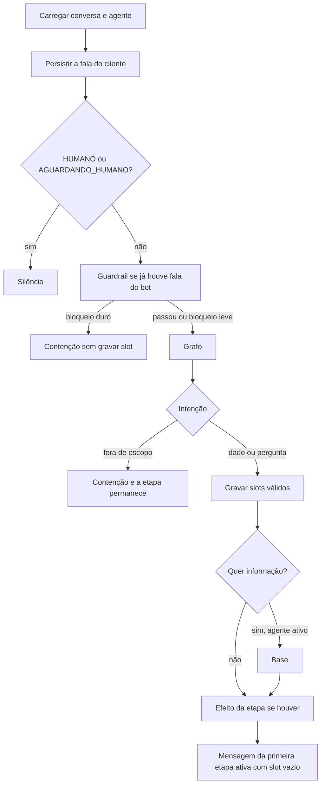
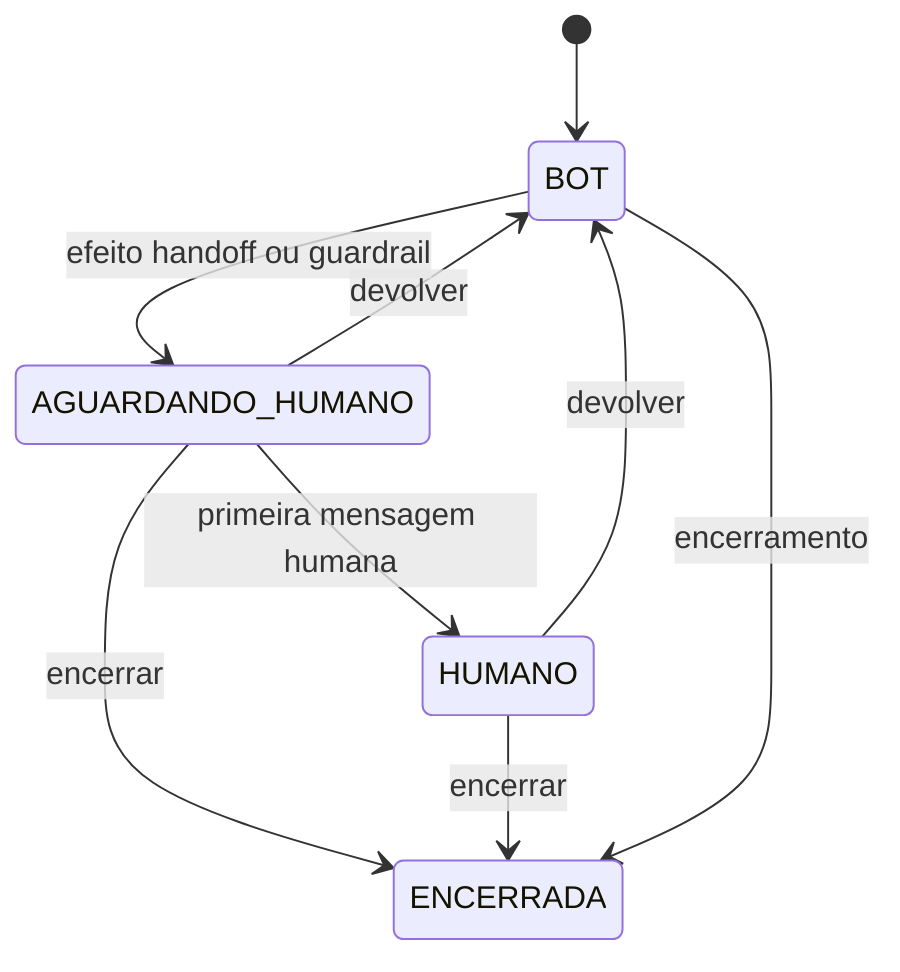

# 02 — Arquitetura

## Princípios

O modelo propõe slots e o julgamento do guardrail. O código aplica: etapa corrente, handoff e silêncio com humano. A configuração vive em dados, validada na escrita. Toda entidade de negócio carrega `empresaId`.

## Turno

`enviarMensagem` grava a fala do cliente, silencia se a conversa não está em `BOT` e chama `MotorEtapasService` com o agente da conversa, ou o agente semeado da empresa. `criarEmpresa` grava nome, e-mail, telefone, CPF, protocolo e handoff. A saudação vem de `persona.saudacao` e é dita uma vez, antes deles. A empresa não cria agente nem etapa.



1. Persistir a mensagem do cliente.
2. Guarda de estado, em código, antes de qualquer modelo. Em `HUMANO` ou `AGUARDANDO_HUMANO` o bot não fala.
3. Guardrail, só se já houve fala do bot. Não consulta horário, política nem artigo. Bloqueio duro não grava slot e não pula a etapa; se `pedirHumano`, chama o handoff e fala o acolhimento do guardrail seguido da mensagem configurada. Bloqueio leve segue: slot válido grava e a mensagem da etapa vence; sem slot novo, a contenção orienta e a etapa fica. A contenção é escrita pelo modelo com a persona, o histórico recente e o número da tentativa. Sem bloqueio e sem avanço, `GuardrailService.redigir` escreve a resposta; se falhar, vale a mensagem da etapa. Cada trava conta na etapa; passou de `limiteTravasPorEtapa`, a conversa vai para a fila ([06](06-modulo-transferencia-humana.md)). JSON inválido não bloqueia.
4. Grafo: reescrever, classificar, extrair os slots vazios deste fluxo, checar e extrair de novo até duas vezes. O schema desse turno é a lista que o orquestrador montou. Uma fala pode preencher vários desses slots. A extração recebe o campo pedido e a última fala do bot, para entender resposta curta como "Ana", e a leitura dos números da fala feita por código (CPF, telefone). Dado de outra etapa também é gravado ([09](09-camada-llm-e-rag.md)). Com `corrigeDado`, também recebe os slots preenchidos e pode trocar o valor. Com `recusaDado`, a etapa fica e o bot oferece atendente. Não reordena etapas e não decide handoff.
5. `querInformacao` liga a busca, com ou sem dado de etapa na mesma fala. `buscar_base` responde o fato. A pergunta da etapa vazia continua. Sem slot novo, a etapa não avança. `fora_de_escopo` contém e não busca. `dado_etapa` grava o que o grafo devolveu e passou no tipo: nome, e-mail, telefone ou CPF.
6. Quando a fronteira é protocolo ou handoff, a tool `abrir_protocolo` ou `pedir_humano` roda no mesmo turno, em sequência até a próxima pergunta ou o handoff. Etapa sem slot é dita uma vez. Na saudação sem dado novo, a tool espera a próxima fala.
7. A próxima fala é o fato, se houve busca, o aviso "Já anotei: …" quando entrou dado de outra etapa, e a mensagem da primeira etapa ativa que ainda tem slot vazio. O modelo não troca o texto da etapa.

`espiar` lê a fronteira e a última fala do bot sem gravar avanço.

## Estados



## Portas

| Porta | Responsabilidade | Adaptador |
|---|---|---|
| `LlmPort` | Texto livre | HTTP Chat Completions. Ver [09](09-camada-llm-e-rag.md). |
| `CLIENTE_ESTRUTURADO` | Guardrail, intenção e extração | SDK da OpenAI com schema Zod. |
| `LogPort` | Eventos do turno | `Logger` do Nest. Troca do adaptador em [15](15-modulo-logs.md). |
| Canal | Entregar a resposta | A própria mutation, síncrona. |

## Estrutura

```
src/modules/
  agente/ conversa/ llm/ conhecimento/ configuracao/ transferencia/ sac/ atendimento/ log/
```

## Pontos de atenção

- O preparar do turno trava a conversa aberta (`FOR UPDATE`). O motor grava o avanço numa transação própria.
- Sem trecho na base, o bot não inventa o fato: usa `mensagemSemBase`.
