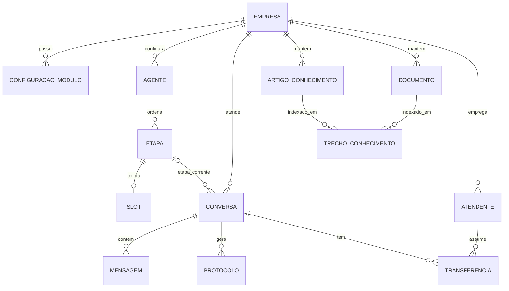

# 03 — Modelo de dados

PostgreSQL via TypeORM. IDs `uuid`. Timestamps `criadoEm`/`atualizadoEm`. Nomes de entidades em pt-BR; colunas em camelCase. Toda tabela (exceto `empresa`) tem `empresaId`. `empresa.nome` é único sem diferenciar maiúsculas nem espaços nas pontas (índice `UQ_empresa_nome`).

## Entidades

| Entidade | Campos principais |
|---|---|
| `Empresa` | `id`, `nome`, `ativa` |
| `ConfiguracaoModulo` | `empresaId`, `modulo` (enum), `ativo`, `config` (JSONB). Único por (`empresaId`, `modulo`) |
| `Agente` | `id`, `empresaId`, `nome`. Único por (`empresaId`, `nome`). Um fluxo da empresa (atendimento, SAC, suporte ou outro nome) |
| `Etapa` | `id`, `empresaId`, `agenteId`, `chave` (`nome`, `email`, `telefone`, `cpf`, `protocolo`, `handoff`), `nome`, `mensagem`, `ordem`, `ativa`, `efeito?`. Único por (`agenteId`, `chave`) quando a chave existe. O catálogo nasce com a empresa. A API não cria nem remove etapa |
| `Slot` | `id`, `empresaId`, `agenteId`, `etapaId`, `nome`, `tipo` (`texto`/`email`/`telefone`/`cpf`/`numero`), `obrigatorio`. Um por etapa. Nome, e-mail, telefone e CPF nascem do catálogo. A API não troca o tipo |
| `Conversa` | `id`, `empresaId`, `agenteId?`, `contatoId` (externo), `canal`, `estado`, `etapaAtualId?`, `valoresSlot` (JSONB), `etapasCumpridas` (JSONB), `saudacaoDita`, `travasPorEtapa` (JSONB, interno), `ultimaMensagemEm` |
| `Mensagem` | `id`, `conversaId`, `autor` (`CLIENTE`/`BOT`/`ATENDENTE`), `texto`, `metadados` (JSONB) |
| `Protocolo` | `id`, `empresaId`, `conversaId`, `numero` (legível, sequencial por empresa, ex. `2026-000123`), `tipo` (`RECLAMACAO`/`DUVIDA`/`SOLICITACAO`), `descricao`, `status` (`ABERTO`/`EM_ANDAMENTO`/`RESOLVIDO`), `encaminhadoParaHumano` |
| `Transferencia` | `id`, `conversaId`, `motivo` (enum), `solicitadaEm`, `assumidaEm?`, `finalizadaEm?`. `assumidaEm` nasce na primeira mensagem humana |
| `ArtigoConhecimento` | `id`, `empresaId`, `tipo` (`PERGUNTA_RESPOSTA`/`INSTRUCAO`), `titulo`, `pergunta?`, `conteudo`, `tags`, `ativo`, `indexacao`, `motivoIndexacao?` |
| `Documento` | `id`, `empresaId`, `nome`, `mime`, `texto`, `status` (`PROCESSANDO`/`PRONTO`/`ERRO`, leitura do arquivo), `motivoErro?`, `indexacao`, `motivoIndexacao?` |
| `TrechoConhecimento` | `id`, `empresaId`, `origem` (`ARTIGO`/`DOCUMENTO`), `artigoId?` ou `documentoId?` (um dos dois, conforme a origem), `ordem`, `titulo`, `secao?`, `texto`, `hash` (sha256 do texto), `embedding` (`vector(1536)`, nulo até indexar), `modeloEmbedding?`, `ativo`, `busca` (`tsvector`). Base do RAG ([09](09-camada-llm-e-rag.md)) |

## Enums
`ModuloTipo`: `ATENDIMENTO_GERAL`, `SAC`, `TRANSFERENCIA_HUMANA`, `BASE_CONHECIMENTO`.
`EstadoConversa`: `BOT`, `AGUARDANDO_HUMANO`, `HUMANO`, `ENCERRADA`.
`MotivoTransferencia`: `PEDIDO_CLIENTE`, `PALAVRA_GATILHO`, `CASO_SAC`, `BAIXA_CONFIANCA`, `FALHAS_REPETIDAS`.
`TipoSlot`: `texto`, `email`, `telefone`, `cpf`, `numero`.
`EfeitoEtapa`: `handoff`, `protocolo`.
`StatusIndexacao`: `PENDENTE`, `PROCESSANDO`, `PRONTO`, `ERRO`. Conteúdo anterior ao RAG nasce `PENDENTE`.
`OrigemTrecho`: `ARTIGO`, `DOCUMENTO`.

## Índices importantes
- `Mensagem(conversaId, criadoEm)`; `Conversa(empresaId, estado)`; `Protocolo(empresaId, numero)` único.
- Busca da base: índice GIN com `tsvector` em `TrechoConhecimento` (config `portuguese`). `ArtigoConhecimento.busca` ainda existe, sem uso na busca.
- RAG: índice HNSW em `TrechoConhecimento.embedding` com `vector_cosine_ops` (distância de cosseno, operador `<=>`). Exige a extensão pgvector: a migration `TrechoConhecimento1793352000000` roda `CREATE EXTENSION IF NOT EXISTS vector` e falha com instrução clara se o Postgres não tiver o pacote. Use a imagem `pgvector/pgvector:pg16`.

## Migrations
Sem `synchronize`. Fluxo em [13](13-como-adicionar-funcionalidades.md).

## Pontos de atenção
- Numeração de protocolo: contador com lock por empresa e ano.
- JSONB de `config` é validado na escrita ([08](08-modulo-configuracao.md)).
- `valoresSlot` e `etapaAtualId` ficam na conversa. Desativar uma etapa tira o slot da lista ativa; o nome do slot continua reservado naquele agente.
